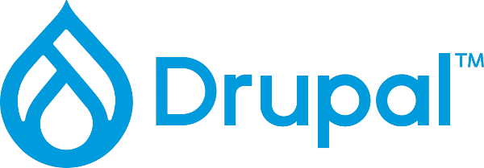

#  Geek's Gadgets and Gizmos
This is my personal blog site, leveraging my extensive experience with . I've also used this project to better understand how to use generative AI and agentic coding in responsible ways. Yes, that will be a blog post... eventually. This file serves as a 100 foot, or even a 1,000 foot overview of the project and what each agent is responsible for.

Detailed implementation, directory structure, and ownership rules live in [ARCHITECTURE.md](ARCHITECTURE.md).

## Backend Overview

This document is a high-level overview of the backend area only. 

### Backend agent responsibility

The backend layer owns Drupal structure and custom module behavior, including:
- Module development in [web/modules/custom/](web/modules/custom/)
- Configuration in [config/sync/](config/sync/)
- Content types, fields, and view configuration
- Hook, route, and entity registration patterns
- Environment and runtime configuration for the Drupal application

### Scope

Core backend areas include:
- Custom module logic and services
- Content model and site structure
- Views and data presentation configuration
- Modern Drupal OOP patterns and attribute-based registration

### Out of scope

Theme implementation, component work, Docker, CI, and infrastructure are not part of this backend overview.

## DevOps Overview

This document is a high-level overview of the DevOps area only. 

### DevOps agent responsibility

The DevOps layer owns the delivery and runtime environment for the Drupal site, including:
- Container and local environment configuration in [docker/](docker/) and [docker-compose.yml](docker-compose.yml)
- CI/CD automation in [.github/](.github/)
- Environment variables and secrets handling through [.env.example](.env.example) and local environment files
- Composer dependency management and patch integrity
- Deployment workflows, Drush configuration sync, and environment parity
- Runtime and infrastructure configuration for the Drupal application

### Scope

Core DevOps areas include:
- Docker and Compose setup for local development
- CI/CD pipelines and automation
- Composer, dependency, and patch management
- DotEnv and environment configuration
- Drush config workflow and deployment hygiene

### Out of scope

Custom module logic, theme implementation, component work, and Drupal content architecture are not part of this DevOps overview.

## Frontend Overview

This document is a high-level overview of the frontend/theme area only. 

### Frontend agent responsibility

The frontend layer owns the Drupal theme implementation and presentation system, including:
- Theme development in [web/themes/custom/triple_g/](web/themes/custom/triple_g/)
- Single Directory Components under [web/themes/custom/triple_g/components/](web/themes/custom/triple_g/components/)
- Design tokens and styling in [web/themes/custom/triple_g/src/scss/](web/themes/custom/triple_g/src/scss/)
- Twig templates, semantic markup, and accessibility-driven structure
- HTML/CSS/JS behavior for interaction patterns using native browser APIs and HTMX where appropriate
- Responsive layout, typography, and brand expression for the site

### Scope

Core frontend areas include:
- SDC component authoring and schema definitions
- Theme templates, page shells, and region composition
- Tokens, typography, spacing, and palette systems
- Performance-conscious CSS and vanilla JavaScript behavior
- Accessibility, focus states, and content readability
- Frontend integration with Drupal entity and view output

### Out of scope

Custom module logic, backend services, route registration, configuration imports, and database/entity architecture are not part of this frontend overview.

## Infrastructure Overview

This document is a high-level overview of the infrastructure/host layer only. 

### Infrastructure agent responsibility

The infrastructure layer owns the production host environment and web-tier runtime for the Drupal site, including:
- Operating system and service configuration for Nginx, PHP-FPM, and Valkey on the VPS host
- Web-server tuning and reverse-proxy behavior in [docker/web/nginx.conf.template](docker/web/nginx.conf.template)
- PHP-FPM pool configuration and runtime tuning in [docker/web/php-fpm-socket.conf](docker/web/php-fpm-socket.conf) and [docker/web/00-php.ini](docker/web/00-php.ini)
- Filesystem ownership, permission hardening, and secret-handling controls for environment files
- Systemd service management, diagnostics, observability, and resource monitoring
- Cache and session runtime configuration for high-throughput anonymous content delivery

### Scope

Core infrastructure areas include:
- Host-level security and least-privilege filesystem setup
- Nginx and PHP-FPM tuning for performance and stability
- Valkey-backed caching and memory policy configuration
- Static file delivery, microcaching, and reverse-proxy optimization
- Logs, metrics, and issue diagnosis at the service layer
- Environment parity and runtime hygiene for deployment systems

### Out of scope

Custom module logic, Drupal content architecture, theme implementation, component work, and application-level feature development are not part of this infrastructure overview.
